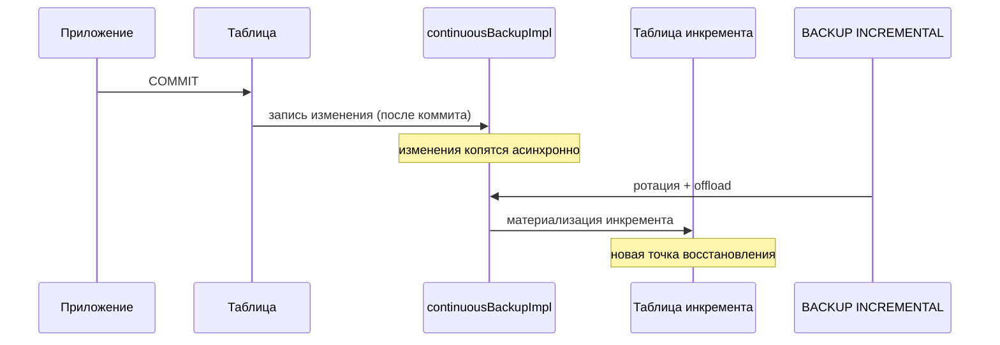
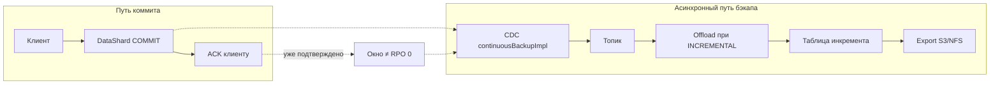

# Инкрементальный бэкап и RPO=0

Документ отвечает на вопрос: **можно ли сделать инкрементальный бэкап с RPO=0 в {{ ydb-short-name }}?**

## Краткий ответ

**Нет — штатный инкрементальный бэкап коллекций не даёт RPO=0.**

| Что нужно | Что даёт {{ ydb-short-name }} сейчас |
|---|---|
| RPO=0: ни одна зафиксированная транзакция не теряется при аварии | RPO ≈ интервал между `BACKUP … INCREMENTAL` (плюс время материализации) |
| Непрерывная точка восстановления «прямо сейчас» | Дискретные точки восстановления — моменты успешных инкрементов в цепочке |
| Синхронная запись копии до ACK клиенту | Асинхронный захват изменений через CDC *после* коммита |

RPO=0 в классическом смысле достигается только **синхронной** репликацией записи (клиент получает успех лишь после durable-копии во второй зоне отказа). Это уже не модель «бэкапа», а модель синхронной реплики. В {{ ydb-short-name }} инкрементальный бэкап построен иначе: непрерывный захват изменений в CDC + периодическая материализация в точки восстановления.

## Что такое RPO в контексте бэкапов

**RPO (Recovery Point Objective)** — максимальный допустимый объём потери данных при восстановлении, обычно выраженный во времени.

- **RPO = 1 час** — при аварии можно потерять до часа транзакций после последней успешной копии.
- **RPO → 0** — почти все зафиксированные изменения уже в копии (типично для near-real-time async replication / continuous log shipping).
- **RPO = 0** — потеря зафиксированных данных недопустима; запись подтверждается клиенту только после durable-копии в независимом хранилище/кластере.

Важно разделять два сценария восстановления:

1. **Логическая ошибка** (ошибочный `DELETE`/`DROP`) — нужна копия *до* ошибки; «свежесть» бэкапа здесь вторична относительно выбора точки во времени.
2. **Авария кластера / потеря зоны** — нужна копия *вне* зоны отказа; тогда RPO напрямую определяет, сколько последних транзакций можно потерять.

## Как устроен инкрементальный бэкап сейчас

Коллекции резервных копий сочетают copy-on-write полный снимок и непрерывный поток изменений. Подробнее — в [{#T}](datamodel/backup-collection.md).

### Непрерывный захват (continuous backup stream)

После полной копии для каждой таблицы создаётся служебный CDC-поток `*_continuousBackupImpl`:

```text
Таблица → CDC (*_continuousBackupImpl) → топик streamImpl
                                              ↓
                                    накопление изменений
                                    между инкрементами
```

Свойства потока (см. [{#T}](cdc.md#guarantees)):

- запись в топик только **после коммита** транзакции в таблице;
- exactly-once, порядок по первичному ключу;
- изменения **непрерывно** попадают в топик — между `BACKUP INCREMENTAL` они не «пропадают», пока жив retention топика.

Это и есть «непрерывная» часть: журнал изменений ведётся постоянно. Но сам топик — ещё не точка восстановления `RESTORE`.

### Дискретная материализация (TakeIncrementalBackup)

Операция `BACKUP collection INCREMENTAL` (внутри — `AlterContinuousBackup` / `TakeIncrementalBackup`):

1. Ротирует continuous backup stream (новый `*_continuousBackupImpl`).
2. Включает offload топика в таблицу инкрементальной копии (PQ `OffloadConfig.IncrementalBackup` → `OffloadActor`).
3. Сохраняет согласованный срез изменений с момента предыдущей копии в `.backups/collections/…/*_incremental/`.



Итог: **захват непрерывный, точки восстановления — дискретные.**

### Чем ограничен RPO

```text
RPO_бэкапа ≈ T_между_инкрементами + T_материализации + T_экспорта_вовне*
```

\*для защиты от потери всего кластера нужен ещё экспорт цепочки во внешнее хранилище ([S3](../reference/ydb-cli/export-import/export-s3.md) / [NFS](../reference/ydb-cli/export-import/export-nfs.md)). Пока инкремент только в кластере, он в той же зоне отказа, что и данные.

Дополнительно:

- Планировщика бэкапов в {{ ydb-short-name }} нет — частоту задаёт внешний cron/оркестратор.
- `RESTORE` восстанавливает к состоянию **последнего** инкремента в цепочке (или префикса цепочки после выборочного импорта), а не к произвольной секунде между инкрементами.
- Произвольный PITR «к любому моменту» в roadmap отмечен отдельно: [Incremental backup and Point-in-time recovery](https://github.com/ydb-platform/ydb/blob/main/ROADMAP.md).

## Почему RPO=0 «как у бэкапа» не получается

| Требование RPO=0 | Реальность инкрементального бэкапа |
|---|---|
| Копия durable до ACK клиенту | CDC пишется **после** коммита; клиент уже получил успех |
| Нет окна потери при аварии mid-flight | Между коммитом и попаданием в топик / offload есть асинхронное окно |
| Независимая зона отказа | In-cluster backup и CDC-топик делят судьбу кластера, пока нет экспорта |
| Восстановление «на последний commit» | Восстановление — на последний **материализованный** инкремент |

Даже механизм [changelog системных таблеток](backup.md#system-tablet-backup-how-it-works) явно асинхронный: документация предупреждает о возможной потере последних незаписанных изменений. Та же физика — у user-data continuous backup.

**Вывод:** назвать инкрементальный бэкап «с RPO=0» нельзя, даже если запускать `BACKUP INCREMENTAL` каждую секунду. Можно лишь **приблизить RPO к нулю**, уменьшая интервал материализации и (для DR) задержку экспорта наружу.

## Что использовать, если нужен очень маленький RPO

### 1. Частые инкременты коллекций (логика / «страховочная» копия)

```yql
-- коллекция с инкрементами
CREATE BACKUP COLLECTION prod_bc (
    TABLE orders,
    TABLE payments
) WITH (
    STORAGE = 'cluster',
    INCREMENTAL_BACKUP_ENABLED = 'true'
);

BACKUP prod_bc;              -- полная
BACKUP prod_bc INCREMENTAL;  -- далее по cron, например раз в N минут
```

- **RPO** ≈ период cron.
- Защита от логических ошибок внутри кластера.
- Для DR — регулярный export каждого звена цепочки наружу.

Подходит, когда допустимы минуты/часы потери при аварии.

### 2. Асинхронная репликация в другой кластер/БД (near-zero RPO)

[{#T}](async-replication.md) поверх CDC даёт near-real-time копию в другой базе:

- отставание `replication_lag = received_at - created_at` видно в describe;
- коммит изменений на приёмнике по умолчанию не чаще раз в 10 с (`COMMIT_INTERVAL`);
- это **реплика**, не бэкап: ошибочный `DELETE` уедет на приёмник.

**RPO → лаг репликации** (секунды…минуты), но **не 0** и без защиты от логических ошибок.

### 3. Собственный continuous shipping CDC во внешнее хранилище

Если нужен «почти continuous backup» вне кластера:

```text
Полный снимок (export) + непрерывное чтение changefeed → S3/другая СУБД
```

- Базовый full + поток изменений дают основу для своего PITR.
- RPO ≈ лаг пайплайна выгрузки (async).
- Сборку произвольной точки во времени и согласованность нескольких таблиц нужно проектировать отдельно (барьеры CDC, виртуальные метки времени).

Штатные backup collections этот пайплайн **не заменяют** и **не делают** синхронным.

### 4. Синхронная запись (единственный путь к строгому RPO=0)

Строгий RPO=0 возможен только если путь записи:

```text
COMMIT → durable primary + durable secondary → ACK клиенту
```

В {{ ydb-short-name }} отказоустойчивость внутри кластера (реплики BlobStorage / tablet) закрывает аппаратные сбои **внутри** выбранной топологии, но не заменяет:

- отдельную копию от логических ошибок (бэкап);
- синхронную кросс-кластерную/кросс-региональную запись с подтверждением (отдельный продуктовый механизм, не инкрементальный бэкап).

## Сравнение по RPO

#|
|| **Механизм** | **Типичный RPO** | **Защита от логических ошибок** | **Защита от потери кластера** ||
|| Полный / инкрементальный бэкап в кластере | Интервал между бэкапами | Да | Нет (та же зона отказа) ||
|| То же + export в S3/NFS | Интервал бэкапа + лаг export | Да | Да ||
|| Continuous CDC-поток бэкапа (до materialize) | Не точка RESTORE | Частично (есть журнал) | Нет ||
|| Async Replication | Лаг репликации | Нет (ошибки реплицируются) | Да (другая БД/кластер) ||
|| Sync replication / sync remote durable | ≈ 0 | Нет | Да, ценой latency ||
|#

## Архитектура «почему не 0» на одной схеме



Любой разрыв между `ACK` и durable-копией во **второй** зоне отказа — ненулевой RPO.

## Практические рекомендации

1. **Не обещать RPO=0** на базе `BACKUP INCREMENTAL`: корректная формулировка — «RPO равен периоду инкрементов (и экспорта)».
2. Для **логических ошибок**: коллекции + достаточно частые инкременты + хранение цепочек.
3. Для **DR с малым RPO**: async replication и/или непрерывный export CDC + периодические full; принять ненулевой лаг.
4. Для **строгого нуля**: только синхронная модель записи (отдельное решение по latency и топологии), не инкрементальный бэкап.
5. PITR к произвольному моменту между инкрементами — отдельная цель roadmap, не свойство текущего `RESTORE`.

## Связь с кодом

Ключевые точки реализации:

- Создание continuous backup CDC: `ydb/core/tx/schemeshard/schemeshard__operation_create_continuous_backup.cpp`
- Ротация и take incremental: `ydb/core/tx/schemeshard/schemeshard__operation_alter_continuous_backup.cpp`
- Инкремент коллекции: `ydb/core/tx/schemeshard/schemeshard__operation_backup_incremental_backup_collection.cpp`
- Offload топика в таблицу инкремента: `ydb/core/persqueue/pqtablet/partition/offload_actor.cpp`
- Proto: `TCreateContinuousBackup` / `TAlterContinuousBackup.TakeIncrementalBackup` в `ydb/core/protos/flat_scheme_op.proto`

## См. также

- [{#T}](datamodel/backup-collection.md) — архитектура коллекций
- [{#T}](backup.md) — обзор способов резервного копирования
- [{#T}](cdc.md) — гарантии CDC
- [{#T}](async-replication.md) — near-real-time копия между БД
- [{#T}](../devops/backup-and-recovery/index.md) — практика backup/restore
- [{#T}](../yql/reference/syntax/backup.md) — `BACKUP` / `BACKUP … INCREMENTAL`
